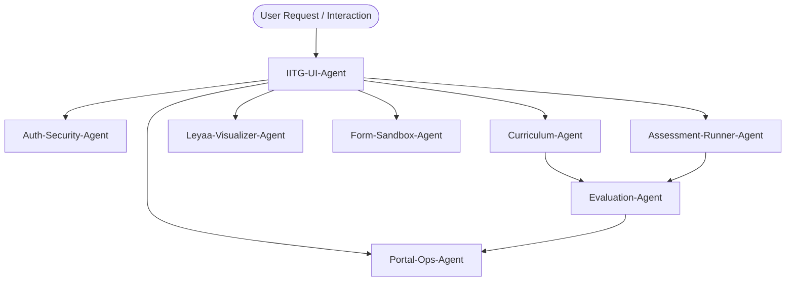

# Virtual Labs (VLab) Agent Architecture Registry

This document defines the agent architecture governing the IIT Guwahati Virtual Labs platform for **Experiment 6: Custom Form Validation using `clean()` and `clean_<fieldname>()` in Django**.

Each feature and sub-system is maintained and operated by a specialized autonomous agent with defined responsibilities, scope, toolchain, and interfaces.

---

## 🧭 Agent Roster & Responsibility Matrix

| Agent Name | Scope / Feature | File Definition | Key Interfaces & Files |
|---|---|---|---|
| **`Auth-Security-Agent`** | User authentication, session management, and RBAC (`STUDENT`, `FACULTY`, `ADMIN`). | [auth_security_agent.md](file:///c:/Users/snmeh/Documents/TY/DJangoLab/Mini_Project/FSD_VLab/.gemini/agents/auth_security_agent.md) | `backend/authentication/`, `frontend/src/context/AuthContext.jsx` |
| **`Curriculum-Agent`** | Academic pedagogy (Aim, Overview, Recap, Pretest, Posttest, References). | [curriculum_agent.md](file:///c:/Users/snmeh/Documents/TY/DJangoLab/Mini_Project/FSD_VLab/.gemini/agents/curriculum_agent.md) | `backend/experiments/`, `frontend/src/components/ModuleViews.jsx` |
| **`Leyaa-Visualizer-Agent`** | 7-step interactive Django form execution tracer modeling `form.is_valid()`. | [leyaa_visualizer_agent.md](file:///c:/Users/snmeh/Documents/TY/DJangoLab/Mini_Project/FSD_VLab/.gemini/agents/leyaa_visualizer_agent.md) | `backend/simulator/engine.py`, `VisualizerView` |
| **`Form-Sandbox-Agent`** | Live form submission workbench with field error & non-field error (`__all__`) rendering. | [form_sandbox_agent.md](file:///c:/Users/snmeh/Documents/TY/DJangoLab/Mini_Project/FSD_VLab/.gemini/agents/form_sandbox_agent.md) | `SimulationView`, `backend/simulator/views.py` |
| **`Assessment-Runner-Agent`** | Python sandbox test runner for student-submitted validation methods (`clean_age()`, `clean()`). | [assessment_runner_agent.md](file:///c:/Users/snmeh/Documents/TY/DJangoLab/Mini_Project/FSD_VLab/.gemini/agents/assessment_runner_agent.md) | `backend/simulator/engine.py`, `CodeAssessmentView` |
| **`Evaluation-Agent`** | Grading calculations, pre/post quiz score tracking, and certificate generation. | [evaluation_agent.md](file:///c:/Users/snmeh/Documents/TY/DJangoLab/Mini_Project/FSD_VLab/.gemini/agents/evaluation_agent.md) | `backend/experiments/views.py`, `PosttestView` |
| **`IITG-UI-Agent`** | IIT Guwahati design fidelity (MoE green beaker logo, `#f37021` divider, cyan breadcrumbs, active sidebar). | [iitg_ui_agent.md](file:///c:/Users/snmeh/Documents/TY/DJangoLab/Mini_Project/FSD_VLab/.gemini/agents/iitg_ui_agent.md) | `frontend/src/components/Header.jsx`, `Sidebar.jsx`, `Breadcrumbs.jsx` |
| **`Portal-Ops-Agent`** | Faculty Gradebook portal, Admin bug report pipeline, user registry, and system health. | [portal_ops_agent.md](file:///c:/Users/snmeh/Documents/TY/DJangoLab/Mini_Project/FSD_VLab/.gemini/agents/portal_ops_agent.md) | `backend/portal/`, `FacultyPortalView`, `AdminPortalView` |

---

## 🔄 Inter-Agent Workflow

