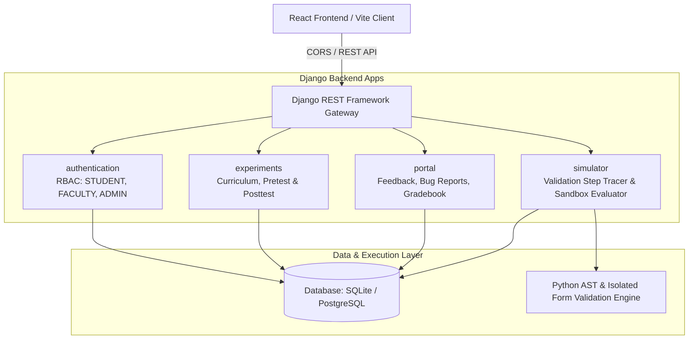

# Django Virtual Labs (VLab) — Complete Backend Architecture & Implementation Plan

**Experiment Topic**: Custom Form Validation using `clean()` and `clean_<fieldname>()` in Django Forms  
**Institution**: K. J. Somaiya School of Engineering (KJSSE)  
**Target Stack**: Python 3.10+, Django 5.x, Django REST Framework (DRF), `django-cors-headers`, SQLite (Development) / PostgreSQL (Production)

---

## 1. System Architecture Overview



---

## 2. Directory & App Structure

The backend repository (`backend/`) is structured into four modular Django applications:

```
backend/
├── manage.py
├── vlab_core/                  # Root project settings & master URL routing
│   ├── __init__.py
│   ├── settings.py
│   ├── urls.py
│   └── wsgi.py
├── authentication/             # Custom User model, RBAC & Auth APIs
│   ├── __init__.py
│   ├── admin.py
│   ├── models.py
│   ├── serializers.py
│   ├── views.py
│   └── urls.py
├── experiments/                # Experiment metadata, Pretest & Posttest Quizzes
│   ├── __init__.py
│   ├── admin.py
│   ├── models.py
│   ├── serializers.py
│   ├── views.py
│   └── urls.py
├── simulator/                  # Core VLab Engine: Step-by-Step Tracer & Code Evaluator
│   ├── __init__.py
│   ├── engine.py               # AST & Custom Validation Tracer Logic
│   ├── forms.py                # Reference Form Definitions
│   ├── serializers.py
│   ├── views.py
│   └── urls.py
└── portal/                     # Lab Submissions, Gradebook, Bug Reports & Feedback
    ├── __init__.py
    ├── admin.py
    ├── models.py
    ├── serializers.py
    ├── views.py
    └── urls.py
```

---

## 3. Database Schema & Data Models

### 3.1 `authentication` App

#### `CustomUser(AbstractUser)`
Extends `django.contrib.auth.models.AbstractUser`.
- `role`: `CharField(max_length=20, choices=[('STUDENT', 'Student'), ('FACULTY', 'Faculty'), ('ADMIN', 'Admin')], default='STUDENT')`
- `department`: `CharField(max_length=100, default='Computer Engineering')`
- `roll_or_faculty_id`: `CharField(max_length=50, blank=True, null=True)` (e.g., `16010124169`)
- `batch`: `CharField(max_length=20, default='D3')`

---

### 3.2 `experiments` App

#### `Experiment`
Curriculum metadata for the laboratory experiment.
- `slug`: `SlugField(unique=True)` (e.g., `django-custom-form-validation-clean`)
- `title`: `CharField(max_length=255)`
- `aim`: `TextField()`
- `overview`: `TextField()`
- `recap`: `TextField()`
- `analysis`: `TextField()`
- `references`: `TextField()`
- `estimated_minutes`: `PositiveIntegerField(default=45)`
- `created_at`: `DateTimeField(auto_now_add=True)`

#### `QuizQuestion`
Multiple-choice questions for diagnostic evaluation.
- `experiment`: `ForeignKey(Experiment, on_delete=models.CASCADE, related_name='questions')`
- `quiz_type`: `CharField(max_length=10, choices=[('PRETEST', 'Pre-Test'), ('POSTTEST', 'Post-Test')])`
- `question_text`: `TextField()`
- `options`: `JSONField()` (List of 4 choices: `["Option A", "Option B", "Option C", "Option D"]`)
- `correct_index`: `PositiveSmallIntegerField()` (0 to 3)
- `explanation`: `TextField()` (Pedagogical explanation shown post-submission)

#### `QuizSubmission`
Records student quiz results and performance analytics.
- `user`: `ForeignKey(settings.AUTH_USER_MODEL, on_delete=models.CASCADE)`
- `experiment`: `ForeignKey(Experiment, on_delete=models.CASCADE)`
- `quiz_type`: `CharField(max_length=10)`
- `score`: `PositiveIntegerField()`
- `total_questions`: `PositiveIntegerField()`
- `answers`: `JSONField()` (Mapping of question IDs to submitted option indices)
- `submitted_at`: `DateTimeField(auto_now_add=True)`

---

### 3.3 `portal` App

#### `CodeSubmission`
Stores student code implementations and automated test outputs.
- `user`: `ForeignKey(settings.AUTH_USER_MODEL, on_delete=models.CASCADE)`
- `challenge_id`: `CharField(max_length=50)` (`clean_age` or `clean_form`)
- `code`: `TextField()`
- `tests_passed`: `PositiveIntegerField(default=0)`
- `total_tests`: `PositiveIntegerField(default=4)`
- `score`: `FloatField(default=0.0)`
- `is_passed`: `BooleanField(default=False)`
- `submitted_at`: `DateTimeField(auto_now_add=True)`

#### `FeedbackSubmission`
Student feedback and rating submissions.
- `user`: `ForeignKey(settings.AUTH_USER_MODEL, on_delete=models.CASCADE)`
- `rating`: `PositiveSmallIntegerField()` (1 to 5)
- `feedback_text`: `TextField(blank=True)`
- `submitted_at`: `DateTimeField(auto_now_add=True)`

#### `BugReport`
Issue tracker for platform errors and UX tickets.
- `user`: `ForeignKey(settings.AUTH_USER_MODEL, on_delete=models.CASCADE)`
- `title`: `CharField(max_length=200)`
- `severity`: `CharField(max_length=20, choices=[('LOW', 'Low'), ('MEDIUM', 'Medium'), ('HIGH', 'High'), ('CRITICAL', 'Critical')])`
- `description`: `TextField()`
- `steps_to_reproduce`: `TextField(blank=True)`
- `status`: `CharField(max_length=20, default='OPEN', choices=[('OPEN', 'Open'), ('RESOLVED', 'Resolved')])`
- `created_at`: `DateTimeField(auto_now_add=True)`

---

## 4. Core Simulation Engine (`simulator/engine.py`)

### 4.1 Step-by-Step Execution Tracer
Simulates Django's internal validation lifecycle step-by-step:

```
[Step 1: Raw POST Received] -> self.data populated
            │
[Step 2: form.is_valid() Triggered] -> invokes self.full_clean()
            │
[Step 3: Field Type Validations] -> Built-in CharField, EmailField, IntegerField checks
            │
[Step 4: Field-Level Hook clean_<field>()] -> e.g., clean_age() verifying age >= 18
            │
[Step 5: Form-Level Hook clean()] -> Cross-field check: password == confirm_password
            │
[Step 6: State Finalization] -> self.cleaned_data populated or self.errors (ErrorDict) returned
```

#### Step Trace Data Contract (Response)
For each execution step, return:
```json
{
  "stepNumber": 4,
  "title": "Field-Level Validation Hook: clean_age()",
  "description": "Django dynamically inspects and runs clean_age() since 'age' passed initial IntegerField validation.",
  "codeSnippet": "def clean_age(self):\n    age = self.cleaned_data.get('age')\n    if age is not None and age < 18:\n        raise forms.ValidationError('Must be at least 18 years old.')\n    return age",
  "highlightLine": 3,
  "variables": {
    "self.cleaned_data": {
      "username": "shlok",
      "email": "shlok@somaiya.edu",
      "age": 16
    },
    "self.errors": {}
  },
  "status": "FAILED"
}
```

### 4.2 Secure Code Assessment Sandbox
To test student-submitted code safely:
1. **AST Validation (`ast.parse`)**:
   - Inspect AST to prohibit dangerous builtins and libraries (`os`, `sys`, `subprocess`, `__import__`, `open`).
   - Validate target function declaration (`def clean_age(self):` or `def clean(self):`).
2. **Dynamic Form Binding**:
   - Bind the extracted function to a mock `forms.Form` class.
3. **Automated Unit Test Runner**:
   - Execute 4 standardized test cases against the form.
   - Return `{ passed, testsPassed, totalTests, score, feedback, testCases: [...] }`.

---

## 5. REST API Endpoints Specification

### 5.1 Authentication (`/api/auth/`)
| Method | Endpoint | Description | Auth Required |
|---|---|---|---|
| `POST` | `/api/auth/register/` | Register new student or faculty account | No |
| `POST` | `/api/auth/login/` | Authenticate and return JWT/Auth Token | No |
| `GET` | `/api/auth/me/` | Fetch current session profile & role | Yes |
| `POST` | `/api/auth/switch-demo-role/` | Development helper to switch role instantly | No (Dev Mode) |

**Sample `/api/auth/switch-demo-role/` Request**:
```json
{
  "role": "FACULTY"
}
```

---

### 5.2 Experiments & Quizzes (`/api/experiments/`)
| Method | Endpoint | Description | Auth Required |
|---|---|---|---|
| `GET` | `/api/experiments/details/` | Retrieve experiment curriculum content | No |
| `GET` | `/api/experiments/quiz/?type=PRETEST` | Retrieve 5 Pre-Test MCQs (answers masked) | Yes |
| `GET` | `/api/experiments/quiz/?type=POSTTEST` | Retrieve 5 Post-Test MCQs (answers masked) | Yes |
| `POST` | `/api/experiments/quiz/submit/` | Grade quiz, record score, and return explanations | Yes |

**Sample Quiz Submission Request**:
```json
{
  "quiz_type": "PRETEST",
  "answers": {
    "1": 2,
    "2": 0,
    "3": 1,
    "4": 3,
    "5": 0
  }
}
```

---

### 5.3 Simulator & Sandbox (`/api/simulator/`)
| Method | Endpoint | Description | Auth Required |
|---|---|---|---|
| `POST` | `/api/simulator/trace/` | Accepts raw form values and returns step trace with variable states | No |
| `POST` | `/api/simulator/assess/` | Evaluates student-written validation method against automated test cases | Yes |

**Sample `/api/simulator/trace/` Request**:
```json
{
  "username": "shlok",
  "email": "shlok@somaiya.edu",
  "age": 16,
  "password": "pass123",
  "confirm_password": "mismatch"
}
```

---

### 5.4 Portal & Dashboards (`/api/portal/`)
| Method | Endpoint | Description | RBAC Role |
|---|---|---|---|
| `POST` | `/api/portal/feedback/` | Submit 5-star rating + review comments | Any Authenticated |
| `GET` | `/api/portal/feedback/` | List all feedback submissions | Faculty & Admin |
| `POST` | `/api/portal/bug-report/` | Submit bug report ticket | Any Authenticated |
| `GET` | `/api/portal/bug-reports/` | List and review open bug tickets | Admin Only |
| `GET` | `/api/portal/gradebook/` | Student roster with Pretest, Posttest & Code scores | Faculty & Admin |
| `GET` | `/api/portal/users/` | Manage and inspect registered users | Admin Only |

---

## 6. Seed Data & Initialization Plan

Create a custom management command `python manage.py seed_vlab`:
1. **Pre-seeded Accounts**:
   - **Student**: `student@vlab.edu` / `Student@123` (Name: Shlok Mehta, Roll: 16010124169, Batch: D3)
   - **Faculty**: `faculty@vlab.edu` / `Faculty@123` (Name: Prof. Sharma, Department: Computer Engineering)
   - **Admin**: `admin@vlab.edu` / `Admin@123` (Name: System Administrator)
2. **Curriculum Seed**:
   - Title: *Custom Form Validation using clean() in Django Forms*
   - Aim, Overview, Theory, and Reference Links.
3. **Assessment Seed**:
   - 5 Pre-Test MCQs covering form definitions, `is_valid()`, and `cleaned_data`.
   - 5 Post-Test MCQs covering `clean_<field>()`, `clean()`, `ValidationError`, and cross-field logic.

---

## 7. Security, CORS & Settings Checklist

In `vlab_core/settings.py`:
- [ ] Add `corsheaders` to `INSTALLED_APPS` and `corsheaders.middleware.CorsMiddleware` at the very top of `MIDDLEWARE`.
- [ ] Configure CORS:
  ```python
  CORS_ALLOWED_ORIGINS = [
      "http://localhost:5173",
      "http://127.0.0.1:5173",
  ]
  CORS_ALLOW_CREDENTIALS = True
  ```
- [ ] Set `AUTH_USER_MODEL = 'authentication.CustomUser'`.
- [ ] Configure `REST_FRAMEWORK`:
  ```python
  REST_FRAMEWORK = {
      'DEFAULT_AUTHENTICATION_CLASSES': [
          'rest_framework.authentication.TokenAuthentication',
          'rest_framework.authentication.SessionAuthentication',
      ],
      'DEFAULT_PERMISSION_CLASSES': [
          'rest_framework.permissions.AllowAny',
      ],
  }
  ```

---

## 8. Git Collaboration Protocol

1. **Strict Directory Isolation**:
   - All backend work happens inside `backend/`.
   - All frontend work happens inside `frontend/`.
2. **Branch Workflow**:
   - Work on feature branches (e.g. `feat/backend-api`, `feat/simulator-engine`).
   - Open Pull Requests to `main`.
3. **Always Pull Before Starting**:
   ```powershell
   git pull origin main
   ```
4. **Local Execution**:
   ```powershell
   cd backend
   python manage.py migrate
   python manage.py runserver 127.0.0.1:8000
   ```
