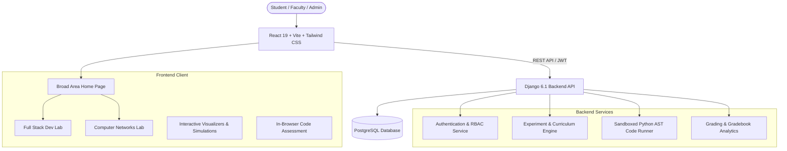

# Virtual Labs (VLab) — Computer Science & Engineering

[](https://www.djangoproject.com/)
[](https://react.dev/)
[](https://tailwindcss.com/)
[](https://www.vlab.co.in/)

An interactive, full-stack **Virtual Laboratory (VLab)** educational platform designed to provide engineering students with remote, hands-on experimentation environments for core Computer Science & Engineering disciplines. Aligned with the pedagogical and visual standards of the **Ministry of Education (MoE, Govt. of India)** Virtual Labs initiative, this platform enables learning through interactive simulations, code sandboxes, visual step-by-step execution traces, and automated assessments—all directly within the browser without requiring local environment configuration.

---

## What Is This Platform About?

Traditional engineering computer labs often face challenges including disparate local machine configurations, accessibility limitations outside campus hours, and difficulty visualizing internal runtime lifecycles (such as network packet propagation or backend framework execution pipelines).

This platform bridges that gap by offering:
- **Zero-Setup Remote Experimentation**: Full access to complex web development and computer networking experiments directly through a modern web browser.
- **Deep Execution Observability**: Interactive visualizers that unpack "black-box" systems—from the step-by-step call stack of a Django form validation cycle to VLAN tagged packet broadcasts across switch ports.
- **Formative & Evaluative Assessment**: Pre-experiment diagnostic quizzes, interactive workbenches, automated in-browser code evaluation sandboxes, post-quizzes, and instant certificate generation.
- **Departmental Breadth**: A scalable, multi-course architecture housed under a unified **Broad Area: Computer Science and Engineering** portal.

---

## Available Laboratories & Experiments

### 1. Full Stack Web Development (FSD) Lab
Focuses on enterprise web application development paradigms, backend architecture, and robust server-side processing.

- **Featured Experiment**: *Custom Form Validation using `clean()` and `clean_<fieldname>()` in Django*
- **Pedagogical Workflow & Modules**:
  - **Aim**: Clear learning outcomes, prerequisites, and industry skill mapping.
  - **Overview**: Architectural breakdown of the Django form validation pipeline (`to_python()`, `validate()`, `run_validators()`), built-in validators, and complete lifecycle flowcharts.
  - **Recap**: Core principles of Django validation—raising `forms.ValidationError`, mutating `cleaned_data`, and cross-field synchronization.
  - **Pretest**: 5-question conceptual diagnostic quiz evaluating form lifecycle readiness.
  - **Step-by-Step Visualizer**: Interactive 7-phase execution tracer displaying real-time call stack progression, syntax-highlighted source code, and live variable state inspector (`self.cleaned_data`, `self.errors`).
  - **Simulation Playground**: Live form submission workbench with instant field-level and form-wide (`__all__`) error feedback alongside toggleable `forms.py` source previews.
  - **Code Assessment**: Built-in browser IDE with sandboxed Python code execution and automated test runners validating student-submitted `clean_age()` and cross-field `clean()` logic.
  - **Analysis**: Comparative matrix (Built-in vs Field-level vs Form-level validation) with execution order reference guides.
  - **Posttest & Certification**: 5-question comprehensive test with dynamic PDF-ready completion certificate issuance upon passing (score $\ge$ 60%).
  - **Faculty Gradebook**: Real-time instructor portal tracking student batch performance with CSV exports.

---

### 2. Computer Networks (CN) Lab
Focuses on data communications, packet forwarding, protocol analysis, and network infrastructure design.

- **Featured Experiment**: *VLAN Configuration & Port-based Network Segmentation (VLAN Switching)*
- **Pedagogical Workflow & Modules**:
  - **Aim**: Understand broadcast containment, IEEE 802.1Q frame tagging, and switch port modes (Access vs Trunk).
  - **Theory**: Comprehensive background on layer-2 broadcast domains, collision domains, VLAN tagging headers, and inter-VLAN routing concepts.
  - **Pretest**: Diagnostic assessment on switch architectures, MAC forwarding tables, and Ethernet frame formats.
  - **Procedure**: Guided step-by-step configuration manual simulating terminal commands and topology verification.
  - **Topology Visualizer**: Interactive network topology view showing networked workstations mapped into isolated broadcast domains (VLAN 10: Faculty / VLAN 20: Students) connected through an intelligent switch.
  - **Simulation Workbench**: Real-time packet generator running intra-VLAN and inter-VLAN ping tests, simulating ARP resolutions, and inspecting live switch MAC address tables (CAM tables).
  - **Posttest**: Verification quiz testing student comprehension of VLAN isolation and frame tagging.
  - **References & Feedback**: Curated network engineering standards and student feedback collection.

---

## User Roles & Access Control (RBAC)

The platform includes built-in role-based access to simulate real academic institute workflows:

| Role | Persona Example | Capabilities & Permissions |
|---|---|---|
| **Student** | Shlok Mehta (Batch D3) | Access all experiments, run interactive visualizers and simulations, submit code for sandbox evaluation, take quizzes, and generate verified course certificates. |
| **Faculty** | Mrs. Kirti Mishra (Dept. of CSE) | Access student gradebooks, review batch analytics, inspect quiz score distributions, and export grading sheets to CSV. |
| **Admin** | System Administrator | Review system activity, monitor laboratory metrics, inspect bug reports, and manage platform health. |

*(Note: Users can switch seamlessly between personas using the profile menu in the header for testing and evaluation.)*

---

## Technical Architecture



### Key Technology Stack:
- **Frontend**: React 19, Vite, Tailwind CSS v4, Lucide Icons, Canvas/SVG-based network and call-stack visualizers.
- **Backend**: Python 3.11+, Django 6.1, Django REST Framework (DRF), SimpleJWT authentication.
- **Code Execution Sandbox**: Secure Python AST parsing and dynamic assertion runner for client code evaluation.
- **Database**: PostgreSQL (hosted on Render / Supabase) with local SQLite compatibility for offline testing.
- **Deployment**: Frontend deployed on Vercel with automated CI/CD from the `main` branch.

---

## Local Development & Setup

### Prerequisites
- Python 3.10 or higher
- Node.js 18 or higher and npm
- Git

### 1. Backend Setup (Django)
```bash
# Navigate to the backend directory
cd backend

# Create and activate a virtual environment (optional but recommended)
python -m venv venv
# Windows:
venv\Scripts\activate
# Linux/macOS:
source venv/bin/activate

# Install dependencies
pip install -r requirements.txt

# Run database migrations
python manage.py migrate

# Seed initial curriculum, quizzes, and default accounts
python seed_db.py

# Start Django development server
python manage.py runserver 127.0.0.1:8000
```
Backend API will be live at: `http://127.0.0.1:8000/`

### 2. Frontend Setup (React + Vite)
```bash
# Open a new terminal and navigate to frontend
cd frontend

# Install npm packages
npm install

# Start development server
npm run dev
```
Frontend will be accessible at: `http://127.0.0.1:5173/`

---

## Default Login Credentials

| Persona | Username | Password | Role | Academic Details |
|---|---|---|---|---|
| **Student (Default)** | `student` | `student` | `STUDENT` | Shlok Mehta, Batch D3, Roll: 16010124169 |
| **Faculty** | `faculty` | `faculty` | `FACULTY` | Mrs. Kirti Mishra (Assigned VLab: Full Stack Development) |
| **Admin** | `admin` | `admin` | `ADMIN` | System Administrator (Full VLab & Faculty Governance) |

---

## Testing & Quality Assurance

Run the automated backend test suite covering authentication, quiz submission, code sandbox security, and gradebook APIs:
```bash
cd backend
python test_api.py
```
Expected output:
```text
18 passed, 0 failed. All backend services operational!
```
