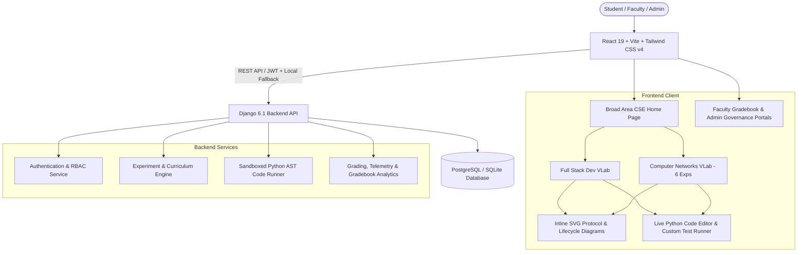

# Virtual Labs (VLab) — Computer Science & Engineering

[](https://www.djangoproject.com/)
[](https://react.dev/)
[](https://tailwindcss.com/)
[](https://www.vlab.co.in/)

An interactive, full-stack **Virtual Laboratory (VLab)** educational platform developed at **K. J. Somaiya School of Engineering (KJSSE)** to provide engineering students with remote, hands-on experimentation environments for core Computer Science & Engineering disciplines. Aligned with the pedagogical and visual standards of the **Ministry of Education (MoE, Govt. of India)** Virtual Labs initiative, this platform enables learning through interactive simulations, live code sandboxes with custom test-case runners, inline architectural vector diagrams, visual step-by-step execution traces, and automated assessments—all directly within the browser without requiring local environment configuration.

---

## What Is This Platform About?

Traditional engineering computer labs often face challenges including disparate local machine configurations, accessibility limitations outside campus hours, and difficulty visualizing internal runtime lifecycles (such as network packet propagation or backend framework execution pipelines).

This platform bridges that gap by offering:
- **Zero-Setup Remote Experimentation**: Full access to web development and computer networking experiments directly through a modern web browser.
- **Deep Execution Observability**: Interactive visualizers and custom inline SVG architectural diagrams (`Diagrams.jsx`) that unpack "black-box" systems—from the 7-stage call stack of a Django form validation cycle to IEEE 802.1Q VLAN frame tagging, Hamming (7,4) syndrome decoding, and Stop-and-Wait ARQ timelines.
- **Live Code Editor & Custom Test Case Runner**: Built-in VS Code-style Python sandboxes where students can write/edit validation and protocol functions, run the built-in unit test suite, and **define & execute their own custom test cases** in real time.
- **Formative & Evaluative Assessment**: Pre-experiment diagnostic quizzes, interactive workbenches, post-experiment quizzes, academic textbook citation cards, and instant verifiable PDF-ready certificate generation.
- **Role-Based Faculty & Admin Governance**: Dedicated portals where faculty can view and update student scores for their assigned VLab, and administrators can monitor faculty-to-VLab assignments, student completion rosters, and average subject scores across laboratories.

---

## Available Laboratories & Experiments

### 1. Full Stack Web Development (FSD) Lab
Focuses on enterprise web application development paradigms, backend architecture, and robust server-side validation pipelines.

- **Featured Experiment**: *Custom Form Validation using `clean()` and `clean_<fieldname>()` in Django* (alongside multi-experiment curriculum modules covering *Django ORM QuerySets*, *JWT & RBAC Middleware*, *DRF Serializers*, *React State & Lifecycle Hooks*, and *CSRF/XSS Security Hardening*).
- **Pedagogical Workflow & Modules**:
  - **Aim**: Clear learning outcomes, prerequisites, and industry skill mapping.
  - **Overview**: Architectural breakdown of the Django form validation pipeline (`to_python()`, `validate()`, `run_validators()`), inline SVG lifecycle flowcharts, and built-in validator mechanics.
  - **Recap**: Core principles of Django validation—raising `forms.ValidationError`, mutating `cleaned_data`, and cross-field synchronization.
  - **Pretest**: 5-question conceptual diagnostic quiz evaluating form lifecycle readiness.
  - **Step-by-Step Visualizer**: Interactive 7-phase execution tracer displaying real-time call stack progression, syntax-highlighted source code, and live variable state inspector (`self.cleaned_data`, `self.errors`).
  - **Simulation Playground**: Live form submission workbench with instant field-level (`errorlist`) and form-wide (`__all__`) error feedback alongside raw HTTP `POST` payload inspection.
  - **Code Assessment (Live Editor + Custom Tests)**: In-browser Python editor supporting `Tab` indentation, dynamic AST/regex logic evaluation for `clean_age(self)` and `clean(self)`, built-in unit tests, and an interactive **Custom Test Case Builder** for testing student-defined edge cases.
  - **Analysis**: Comparative matrix (Built-in vs Field-level vs Form-level validation) with execution order reference guides.
  - **Posttest & Certification**: 5-question comprehensive evaluation with dynamic completion certificate issuance upon passing (score $\ge$ 60%).
  - **References & Contributors**: Accredited textbook citation cards, official documentation links, and the Contributors & Subject Matter Experts directory.

---

### 2. Computer Networks (CN) Lab
Focuses on data communications, error control, IPv4 subnetting, layer-2 switching, reliable transport, and layer-3 packet forwarding across **6 interactive experiments**:

1. **Network Diagnostics (`cn-network-diagnostics`)**: *Ping, Traceroute & Netstat Analysis* — ICMP Echo Request/Reply (Type 8 / Type 0) and TTL expiry trace simulation.
2. **Error Detection & Correction (`cn-hamming-code`)**: *Hamming Code (7,4) Simulator* — Even/Odd parity bit generation, single-bit fault injection, and binary syndrome decoding.
3. **IPv4 Addressing & Subnetting (`cn-ip-subnetting`)**: *CIDR & VLSM Subnet Calculator* — Bitwise mask visualization, network/broadcast computation, and usable host range analysis.
4. **VLAN Configuration & Switching (`cn-vlan-switching`)**: *IEEE 802.1Q Port-Based Network Segmentation* — Access vs Trunk port simulation, broadcast containment across VLAN 10/20, and MAC (CAM) table inspection.
5. **Flow Control Protocols (`cn-stop-wait-arq`)**: *Stop-and-Wait ARQ Interactive Timeline* — Sequence numbering (`Frame 0`/`1`), next-expected `ACK` propagation, frame corruption, and retransmission timeout (RTO) recovery.
6. **IP Packet Forwarding (`cn-static-routing`)**: *Static Routing & Default Route (`0.0.0.0/0`) Configuration* — Longest Prefix Match (LPM) routing table lookups and Cisco IOS `ip route` CLI verification.

Each CN experiment includes:
- **Overview & Recap** with custom inline SVG protocol diagrams (`Diagrams.jsx`)
- **Pretest & Posttest** diagnostic quizzes with instant explanations and completion certificates
- **Step-by-Step Visualizer & Simulation Workbench**
- **Live Python Protocol Code Editor & Custom Test Case Runner**
- **Comparative Analysis & Academic Textbook Reference Cards**

---

## User Roles & Access Control (RBAC)

The platform includes role-based access control tailored for academic laboratory management:

| Role | Persona | Capabilities & Permissions |
|---|---|---|
| **Student (Default)** | Shlok Mehta (Batch D3) | Access all FSD & CN experiments, run interactive visualizers and simulations, write code & run custom test cases, take quizzes, and generate verified completion certificates. |
| **Faculty** | Mrs. Kirti Mishra (KJSSE) | View only their assigned VLab roster, edit and publish live student Pretest/Posttest/Code scores in real time, add new student records, and export batch gradebooks to CSV. |
| **Admin** | System Administrator | Full multi-VLab oversight: inspect which faculty is assigned to which VLab, view all students who completed each lab, track subject-wise average scores, and filter student rows by assigned faculty/VLab. |

---

## Contributors & Subject Matter Experts

### Subject Matter Experts
| Name | Designation / Role | Institution | Department |
|---|---|---|---|
| **Mrs. Kirti Mishra** | Professor & Subject Matter Expert | K. J. Somaiya School of Engineering (KJSSE) | Computer Engineering |
| **Dr. Debasis Samanta** | Professor & Subject Matter Expert | Indian Institute of Technology (IIT), Kharagpur | Computer Science & Engineering |

### Student Contributors (Development Team)
| Name | Roll Number | Role | Institution | Department |
|---|---|---|---|---|
| **Shlok Mehta** | `16010124169` | Lead Developer (UI & Full Stack Simulation) | K. J. Somaiya School of Engineering (KJSSE) | Computer Engineering |
| **Dhruv** | `16010124216` | Co-Lead Developer (Backend Engine & Curriculum) | K. J. Somaiya School of Engineering (KJSSE) | Computer Engineering |

---

## Technical Architecture



### Key Technology Stack
- **Frontend**: React 19, Vite 8, Tailwind CSS v4, Lucide Icons, custom SVG architectural & protocol diagrams (`Diagrams.jsx`).
- **Backend**: Python 3.11+, Django 6.1, Django REST Framework (DRF), SimpleJWT authentication.
- **Code Execution Sandbox**: Dual-mode evaluation (Backend Python AST sandbox + client-side dynamic Python validator/protocol runner supporting custom student test cases).
- **Database**: PostgreSQL (production) / SQLite (local development) with resilient client-side state synchronization.
- **Deployment**: Frontend deployed on Vercel with automated CI/CD from the `main` branch.

---

## Local Development & Setup

### Prerequisites
- Python 3.10 or higher
- Node.js 18 or higher and npm
- Git

### 1. Backend Setup (Django)
```bash
# Navigate to the backend directory
cd backend

# Create and activate a virtual environment (optional but recommended)
python -m venv venv
# Windows:
venv\Scripts\activate
# Linux/macOS:
source venv/bin/activate

# Install dependencies
pip install -r requirements.txt

# Run database migrations
python manage.py migrate

# Seed initial curriculum, quizzes, and default accounts
python seed_db.py

# Start Django development server
python manage.py runserver 127.0.0.1:8000
```
Backend API will be live at: `http://127.0.0.1:8000/`

### 2. Frontend Setup (React + Vite)
```bash
# Open a new terminal and navigate to frontend
cd frontend

# Install npm packages
npm install

# Start development server
npm run dev
```
Frontend will be accessible at: `http://127.0.0.1:5173/`

---

## Testing & Quality Assurance

Run the automated backend test suite covering authentication, quiz submission, code sandbox security, and gradebook APIs:
```bash
cd backend
python test_api.py
```
Expected output:
```text
18 passed, 0 failed. All backend services operational!
```
